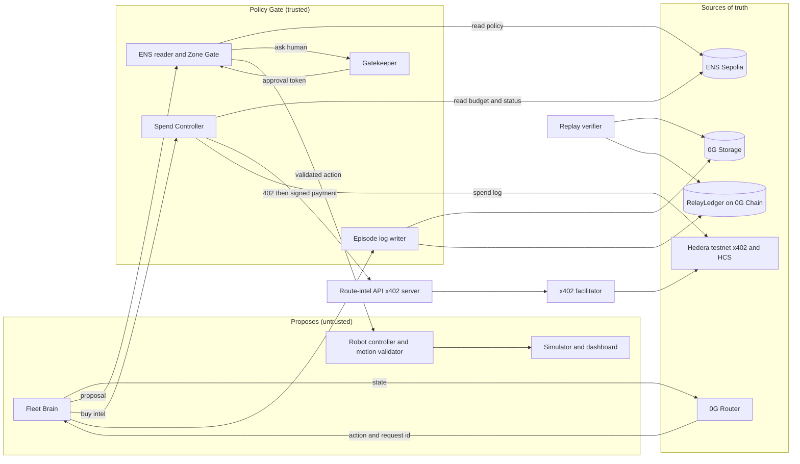

# ROADMAP.md — Dabbawala Protocol (ETHGlobal Mumbai 2026)

> **Purpose:** the single source of truth for WHAT to build and WHEN.
> **Companions:** `AGENTS.md` (how the agent behaves) · `REFERENCES.md` (verified facts and links).
> **Origin:** distilled from `Dabbawala_Protocol_Master_Evaluation.docx` (Oct 25–26, 2026). Where that document and this file disagree, ask the human. Where any file disagrees with an official sponsor page read live, the official page wins and the conflict must be logged in `docs/DECISIONS.md`.

---

## 0. How the agent uses this file

1. Read this file fully at the start of every session, then read `docs/STATE.md`.
2. Work on the **first unchecked task of the current phase**. One task at a time.
3. When a task is done: tick the box, add the evidence (test output, tx id, link, screenshot path) in `docs/PROGRESS.md`, commit.
4. Do **not** edit sections 1–4 (mission, constraints, scope, architecture) without human approval. Propose changes in `docs/DECISIONS.md` instead.
5. If a task needs a fact that is not in `REFERENCES.md`, stop, fetch the official doc, add it to `REFERENCES.md` with a source and date, then continue. Never guess.

**Task status legend:** `[ ]` todo · `[~]` in progress · `[x]` done with evidence · `[!]` blocked · `[-]` cut (state reason)

**Evidence tags (use them in every report):** `VERIFIED` (read on an official page or proven by a test you ran) · `INTERPRETATION` (a reading of official text) · `HYPOTHESIS` (needs a spike) · `UNKNOWN` (not found).

**Timing:** hours below are counted from the hacking start time. The start time is **UNKNOWN** until the human records it in `docs/STATE.md`. The hard stop is **Saturday Nov 7, 2026, 09:00 IST** (VERIFIED on ETHGlobal's own page; secondary sources saying Nov 8 are wrong). Code freeze = deadline minus 2 hours = **07:00 IST**. Shift every cutoff if the real window is shorter than 36 hours.

---

## 1. Mission

**One-line pitch:** Dabbawala Protocol gives every robot a public passport, a spending limit it cannot raise and a stop button it cannot ignore, then lets anyone replay why it did what it did.

**Thesis:** *separation of authority from the agent.* The robot and the model only **propose**. A trusted Policy Gate (ENS reader, Spend Controller, Zone Gate, Gatekeeper, local motion validator) decides what may happen. Public records and logs, not the dashboard, hold the truth.

**Product framing:** a verifiable, bounded-authority operating layer for Physical AI. The delivery simulator is the demo vehicle, not the product. It is a **simulation** and must say so everywhere.

**Users (personas the judges play):** a *fleet operator* and a *safety officer*.

**Metaphor (use it to shape the product):** Mumbai's dabbawala relay. Coded boxes, named handoffs, checkpoints, a logbook.

### Final MVP definition (the finish line)

By Nov 7, 09:00 IST: three simulated robots with ENS passports on Sepolia (each on **its own resolver**) run a three-checkpoint route in which:

1. each checkpoint decision comes from a **real 0G call** and is logged with its request id;
2. at least one leg is paid for through a **real x402 payment on Hedera testnet** by a **Spend Controller** with no human approval;
3. a restricted-zone request is **denied** and another is **approved** through a Gatekeeper;
4. a safety officer **halts one robot via one ENS field** while a robot key's attempt to edit that field **reverts**;
5. **blocking 0G halts a robot** with no substitute decision;
6. the episode **replays from 0G Storage** with a root that matches the registry contract on 0G Chain;

all in a public repo with steady commits, a live demo link and a 2:40–2:50 video.

---

## 2. Hard constraints

| # | Constraint | Status |
|---|---|---|
| C1 | Submit to **exactly three** partner prizes: **0G Physical AI**, **Hedera x402**, **ENSv2**. A submission may select up to 3 partner prizes. World and Chainlink are NOT prize targets | VERIFIED (Master Eval); re-check rules page |
| C2 | Hard stop Sat Nov 7 2026 09:00 IST; freeze 07:00 IST | VERIFIED; start time UNKNOWN |
| C3 | Classic "from scratch" track: no prior project-specific code, designs or assets. Planning docs are committed as disclosed spec artifacts. No code, mockups or Figma before the start | INTERPRETATION; human is asking ETHGlobal in writing |
| C4 | Public repo from the start. Commit frequently in small increments. No single end-of-event commit | VERIFIED |
| C5 | Document all simulated and mocked components in the README | VERIFIED |
| C6 | Video: ETHGlobal accepts 2:00–4:00; 0G requires under 3:00. Target **2:40–2:50**. Real voice, laptop recording, 720p or higher, no speed-up, no AI voiceover, no phone recording | VERIFIED |
| C7 | 0G: a fallback that **fakes a decision disqualifies**. Safe-stop only | VERIFIED |
| C8 | Prize payouts are at partner discretion. Realistic ceiling is $8.5K (first place in all three). Never present prize amounts as expected | VERIFIED |
| C9 | No "first", "only" or "novel primitive" claims. Overlap with Hands Unchained and zerobot must be acknowledged in the README | VERIFIED |
| C10 | Testnets only. No mainnet funds. No real identity data | Project rule |

---

## 3. Scope

### Must have (MVP)
- One working route with 3 checkpoints, deterministic seed
- 0G decision at every checkpoint; request id captured; closed action set
- Safe-stop on 0G failure; recovery only after a fresh 0G success and a fresh policy read
- Episode log (JSONL) → 0G Storage; root anchored on a **RelayLedger** contract on 0G Galileo
- Replay verifier (re-hash and compare with the registry)
- 3 robots as ENSv2 names on Sepolia, **one Permissioned Resolver each**, scoped roles
- Spend Controller (separate process, sole holder of the Hedera key) + x402 route-intel server + at least one real settled payment with a tx id
- One restricted zone with approve, deny, expire and replay-rejected paths
- Dashboard with the six screens in section 8
- README, verified contracts, live demo link, video

### Should have
- HCS audit topic for spends
- Budget-exhaustion scene (refusal plus an operator-ask event)
- Scenario buttons: Monsoon, Budget squeeze, 0G outage
- Delivery-complete summary card

### Stretch
- Evidence Score and the "Replay-verified" badge
- World auth adapter behind the Gatekeeper interface
- Relay handoff where one robot pays another over x402

### Cut (do not build)
World as a prize target, Chainlink CRE, real hardware, sound, leaderboards, avatars, ENS aliasing, expiring or non-transferable subnames, HTS custom fees, A2A negotiation, vision models.

### Hard cut order when time slips
relay market → Evidence Score → Chainlink (already cut) → hardware (already cut) → HCS log → scenario buttons beyond one → World integration → approver expiry states.

### NEVER cut
The 0G loop with safe-stop · the Hedera payment with a tx id · the ENS scoped-role scene · the replay · the registry contract address.

---

## 4. Architecture

### 4.1 Trust zones



### 4.2 Components, sources of truth, failure modes

| Component | Source of truth | Failure mode | Trust assumption |
|---|---|---|---|
| Simulator and dashboard | The episode log (never its own state) | Stale view | Display only |
| Robot controller + motion validator | Hard-coded grid limits | Rejects any unapproved move | Must work with no network |
| Fleet Brain | None; holds proposals | Halts on any invalid result | **Untrusted** |
| ENS reader + Zone Gate | ENS Sepolia, read with block number | Fails closed if ENS unreadable | RPC honesty |
| Spend Controller | ENS policy + its own **hard ceiling** and counters | Refuses, never guesses | Holds the **only** payment key |
| Gatekeeper | Its own pending-action store | Zone stays closed | Its signing key; mocked identities |
| Route-intel API | Its price list | Returns 402 again | Facilitator + Mirror Node |
| Episode log writer | Local JSONL, then 0G Storage | Marks episode `unanchored` | Public data |
| RelayLedger (0G Chain) | The chain | Retry | Chain finality |
| Replay verifier | Downloaded file + registry | Reports mismatch | Honest recomputation |

**Consistency model:** nothing is atomic across chains. ENS = policy, Hedera = payments, 0G Storage = episode, 0G Chain = anchor. The episode file carries the ids that tie them together (policy block number, tx ids, request ids). The registry root is the anchor; ENS `last-episode` is advisory and may lag; HCS is an audit trail. When sources disagree the verifier says so; it does not pick one.

### 4.3 Architecture invariants (never violate)

1. The robot process holds **no** payment key. Only the Spend Controller signs.
2. The model's output is an **untrusted proposal**. Validate against a **closed action set** and a schema; re-check against policy.
3. **Fail closed.** Policy unknown means no new authority. ENS unreadable means no payments and no zone entry.
4. **No substitute decision.** On 0G timeout, transport error, malformed output or out-of-set action: at most one retry to 0G, then halt on a safe cell with a reason code. No cache, no local model, no default turn.
5. Resume only after a **fresh successful 0G call and a fresh policy read**.
6. Route-intel text is **data, never instructions**. The model never sees keys.
7. Approval tokens are **single-use**, bound to robot, zone, nonce and 0G request id, valid 60 seconds or less. Pending actions expire at about 120 seconds.
8. A valid human with no authority for that zone gets 403 and no token.
9. Budget changes are operator-only on ENS, and the Spend Controller enforces its own deploy-time **hard ceiling** that ENS cannot exceed.
10. Episode logs are **public and permanent**. No keys, no personal data. Lint before upload.
11. Every displayed value carries its source and a block number. Mark stale after 15 seconds.
12. Motion safety stays on the device in principle. This project simulates the robot and must say so.

### 4.4 Halt reason codes (PROPOSED; freeze in H0)
`ZG_TIMEOUT` · `ZG_TRANSPORT` · `ZG_MALFORMED` · `ACTION_NOT_ALLOWED` · `ENS_UNREADABLE` · `POLICY_PAUSED` · `BUDGET_EXHAUSTED` · `PAYEE_NOT_ALLOWED` · `OVER_CAP` · `FACILITATOR_DOWN` · `GATE_DENIED` · `APPROVAL_EXPIRED` · `APPROVAL_REPLAYED` · `ZONE_REMOVED`

### 4.5 Interfaces to freeze in hour 0 (PROPOSED TypeScript; confirm with the human)

```ts
type RobotId = "andheri-01" | "bandra-02" | "colaba-03";

type Action =
  | { type: "continue" }
  | { type: "reroute"; routeId: string }
  | { type: "handoff" }
  | { type: "ask_human"; zoneId: string };

type PolicySnapshot = {
  robotId: RobotId;
  zones: string[];
  budgetAtomic: string;      // integer string, USDC has 6 decimals
  status: "active" | "paused";
  block: bigint;             // ENS read block
  valuesHash: string;        // hash of the values read
  readAtMs: number;
};

type Halt = { halted: true; reason: HaltReason; detail?: string };

// B
decide(state: StateSummary): Promise<{ action: Action; requestId: string } | Halt>
// C
buyIntel(legId: string): Promise<{ intel: unknown; txId: string } | { refused: true; ruleId: string }>
readPolicy(robotId: RobotId): Promise<PolicySnapshot>
// A
applyAction(robotId: RobotId, action: Action): ApplyResult
```

Validate every boundary with a schema library (zod or equivalent). No `any`.

### 4.6 Episode log (PROPOSED JSONL; freeze in H0)
One JSON object per line: `seq`, `tsMs`, `robotId`, `type` (`decision` | `payment` | `policy_read` | `gate` | `halt` | `resume` | `anchor`), `policyBlock`, `policyHash`, `requestId`, `txId`, `hcsSeq`, `action`, `reason`. A header line carries seed, scenario and schema version. A footer line carries the root hash. The verifier re-hashes the whole file and compares it with the RelayLedger root.

### 4.7 RelayLedger contract (0G Galileo)
About 20 lines. Name it **RelayLedger**, not `EpisodeRegistry` (that name belongs to Hands Unchained). `anchor(bytes32 robotId, bytes32 episodeId, bytes32 rootHash)` emits an event with the root hash. Foundry tests. Verify on the explorer. The deployment address is **required** for the 0G submission.

### 4.8 ENS design (HYPOTHESIS until spike S-ENS is green)

| Piece | Design |
|---|---|
| Parent | One parent name on Sepolia ENSv2 owned by the fleet operator |
| Robots | `andheri-01`, `bandra-02`, `colaba-03` as subnames, each pointed at **its own** Permissioned Resolver proxy deployed through the Verifiable Factory. Initial records are written in the same initialize call |
| Records | `agent-context` and `agent-endpoint[web]` (ENSIP-26, a draft), plus `zones`, `budget`, `status`, `last-episode`, `hedera-account` |
| Fleet operator | Root `ROLE_SET_TEXT` on each resolver; the **only** holder of link and upgrade roles |
| Safety officer | `grantSetterRoles` for `setText(status)` only |
| Robot key | `grantSetterRoles` for `setText(last-episode)` on **its own** resolver only. No registry roles |

**Why one resolver per robot:** the docs state there is no per-name scoping. A role on one resolver applies to every name it serves. Sharing a resolver would let robot A overwrite robot B. Never give `ROLE_LINK` or `ROLE_UPGRADE` to the safety officer or a robot.

**Fallback if per-robot resolvers will not deploy in time:** one resolver, scope by key (`last-episode.andheri-01`, `status.andheri-01`). State the limitation in the README. **Swap rule:** decide at the hour-4 gate. If ENS cannot be made central, take World as the third prize instead.

The robot can still write junk into its own `last-episode`. Consumers must verify it against the RelayLedger, never trust it.

### 4.9 Spend Controller policy (checked in this order)
1. ENS `status` is `active`.
2. `payTo` is on the payee allowlist.
3. Amount is at or below the per-request cap.
4. Running total is at or below the ENS budget **and** the hard ceiling.
5. Idempotency key unused; budget counter updated under a lock.

If any check fails: refuse, log the rule id, never sign. Cache policy at most **10–15 seconds** with block number and values hash, and log the policy epoch with every decision and payment. The stale-policy window is real and must be stated in the README.

### 4.10 Payment flow (Hedera x402, exact scheme)
Controller `GET /route-intel` → server `402` with payment requirements (scheme exact, network `hedera:testnet`, asset, amount, payTo) → policy check → sign a Hedera `TransferTransaction` → retry with the payment header → server calls the facilitator to verify and settle → server confirms on the Mirror Node → returns intel plus tx id → controller appends the spend to the HCS topic and the episode log. A reused payment header must get `402` again. Pay for the **next** leg's intel while the robot moves; decide at the checkpoint. Exact field names live in the Hedera exact-scheme spec: confirm in spike S-X402 (see `REFERENCES.md`).

### 4.11 Gatekeeper journey
Robot action `ask_human` → Gatekeeper stores a pending action (robot, zone, route hash, 0G request id, nonce, ~120 s expiry) → approver authenticates fresh → approver shown the exact robot, zone and route → approve or deny → approval mints a single-use token → Zone Gate verifies it, **re-reads zones and policy epoch at entry**, and marks it consumed. Deny, cancel, expiry and replay all leave the gate closed and the robot reroutes. Default approver auth is an **in-app allowlist per zone**. A World auth adapter sits behind the same interface and is stretch only. World proves a human authenticated; it does not approve the business action.

### 4.12 Proposed repo layout (confirm in H0)
```
/
├── AGENTS.md  ROADMAP.md  REFERENCES.md  README.md  LICENSE
├── docs/        PROGRESS.md  spikes/  evidence/
├── packages/    shared/ (types, schemas, halt codes, event schema)
├── apps/        dashboard/ (map, passports, ticker, replay, approver page)
├── services/    fleet-brain/  spend-controller/  route-intel/  gatekeeper/  simulator/
├── contracts/   relay-ledger/ (Foundry)  ens-setup/ (scripts)
└── tools/       verifier/  log-lint/
```

---

## 5. Phased plan

Every task has an owner role: **A** simulator and controller · **B** 0G and Fleet Brain · **C** chain identity and payments · **D** frontend, Gatekeeper, demo. With 3 people, merge A into D and B. If one agent does everything, work in this order and never skip a gate.

### Phase P — Before the event (human only; NO project code)
- [ ] **P-1** Ask ETHGlobal in writing (Discord or email) whether a pre-event text proposal is acceptable under the from-scratch rule. Get the actual hacking start time from the Hacker Dashboard. Record both in `docs/STATE.md`
- [ ] **P-2** Create and fund accounts: Sepolia ETH, 0G Galileo testnet funds, Hedera testnet account (plus USDC association or HBAR), 0G Router credits. Registration closes Nov 3 (secondary source)
- [ ] **P-3** Read every linked doc in `REFERENCES.md` marked "read before H0" so hour 0 is execution, not discovery
- [ ] **P-4** Name the **swap-rule owner** (one person who calls ENS-or-World at hour 4)
- [ ] **P-5** Install the toolchain only (Node LTS, pnpm, Foundry, git). Store keys in a password manager. Do not create the project repo's code
- [ ] **P-6** Agree the shared types and event schema **on paper**

### Phase H0 — Hour 0–1: repo and contracts between roles
- [ ] **H0-1** Create the **public** repo, LICENSE, `.gitignore`. First commit contains the planning docs, labelled as disclosed spec artifacts
- [ ] **H0-2** pnpm workspace + `packages/shared` with the frozen types, schemas, halt codes, event schema (section 4.5, 4.6)
- [ ] **H0-3** `.env.example`, secrets policy, pre-commit secret scan
- [ ] **H0-4** `pnpm test:all` stub that runs and passes
- [ ] **H0-5** Confirm deadlines and role ownership
- [ ] **H0-6** Maintain `docs/PROGRESS.md`

**Gate H0:** every role can run a hello script; types compile. No other code before this.

### Phase S — Hour 0–4: four spikes in parallel
Each spike writes `docs/spikes/<name>.md` with exact commands, versions, results, latency numbers and links. A spike is done only when its acceptance line is demonstrated.

- [ ] **S-0G (B)** One 0G Router call with `verify_tee: true`; capture the id from the `ZG-Res-Key` response header; run at least 20 calls and record p50 and p95; one 0G Storage upload with the root hash and its latency; deploy a trivial RelayLedger on Galileo. **Accept:** id and root hash printed; p95 recorded. **Fallback:** zerobot mock robot plus Router only; upload deferred to episode end
- [ ] **S-ENS (C)** Sepolia parent name; one subname with its **own** resolver proxy; `setText` by the operator; `grantSetterRoles` to a second key; read via viem; one reverted write showing `EACUnauthorizedAccountRoles`. **Accept:** viem read works and the revert is seen. **Fallback:** swap rule, or per-key scoping on one resolver
- [ ] **S-X402 (C)** Build `@x402/hedera` from the x402 monorepo source (the docs said it is not on npm; re-check) or write the exact-scheme signer with the Hiero SDK; a 402 endpoint; one payment through the Official x402 facilitator and one through Blocky402; replay a used header. **Accept:** a tx id opens on HashScan. **Fallback:** settle in HBAR; the other facilitator; self-signed exact client (allow 2–3 hours)
- [ ] **S-SIM (A)** Grid with one robot and 3 checkpoints, deterministic seed. **Accept:** the same run twice gives identical logs. **Fallback:** reuse the zerobot mock robot

### Gate G4 — Hour 4: go or swap
- [ ] **G4** For each spike record GO or SWAP in `docs/DECISIONS.md`. Apply the ENS-or-World swap rule if needed. All four green, or the swap applied, or **stop and report** to the human. Cut World and the relay market permanently

### Phase B — Hour 4–14: one ugly end-to-end loop
- [ ] **B-1 (A)** Simulator, robot controller and motion validator, seed, `applyAction`. City with kitchens, relay stations, a restricted gate, a flooded lane
- [ ] **B-2 (B)** Fleet Brain: bounded state summary, 0G call, strict schema validation against the closed action set, request id capture, safe-stop state machine with one retry
- [ ] **B-3 (B)** Episode log writer (JSONL), `log-lint` (no secrets), upload at episode end, anchor on RelayLedger. States: stored → anchored → verified
- [ ] **B-4 (B)** RelayLedger contract, Foundry tests, deployed and verified on the 0G explorer; address recorded in `README.md`
- [ ] **B-5 (B)** Replay verifier: re-hash the downloaded file and compare with the registry
- [ ] **B-6 (C)** Spend Controller: policy reads with cache and epoch, ordered checks, idempotency, lock, hard ceiling, Hedera signing, HCS append
- [ ] **B-7 (C)** Route-intel x402 server: price list, 402 response, facilitator verify and settle, Mirror Node confirmation, reuse rejection
- [ ] **B-8 (C)** Deploy three robots with their own resolvers and roles; `readPolicy` returns block-stamped snapshots
- [ ] **B-9 (D)** Dashboard skeleton consuming the event stream; passports panel with live ENS reads; evidence ticker

**Milestone M1 (hour 14):** an end-to-end run with request ids in the log, one paid leg, one refused leg, and a replay reading the stored file. **Fallback:** hard-code intel but keep the 0G call real.

### Phase I — Hour 14–24: integrate and break things on purpose
- [ ] **I-1** Safe-stop on a real 0G block; recovery after restore (tests G2, G4)
- [ ] **I-2** Safety officer halts **one** robot through one ENS field while the others continue; robot-key edits revert (E2–E5, I2)
- [ ] **I-3** Gatekeeper: pending-action store, per-zone approver allowlist, single-use tokens, expiry (H1–H7)
- [ ] **I-4** Zone Gate: verifies token; re-reads zones and policy epoch at entry
- [ ] **I-5** HCS spend log; budget-exhausted flow (P5)
- [ ] **I-6** Outage tests X1–X3 and the failure matrix in section 7
- [ ] **I-7** Concurrency tests U2 and replay-protection tests P3

**Milestone M2 (hour 24):** every negative test in section 6 has been run once and its evidence saved. **Fallback:** cut HCS, then approver expiry states.

### Phase V — Hour 24–30: polish (map art capped at 4 hours total)
- [ ] **V-1** Mission control: SVG city map as the hero (about 60% of the screen)
- [ ] **V-2** Robot passport drawer with block-stamped records and role holders
- [ ] **V-3** Checkpoint decision card with a 3.0 s countdown ring
- [ ] **V-4** Approver page: approved, denied, expired, already used, not authorised
- [ ] **V-5** Safe-stop overlay naming the cause and the resume condition
- [ ] **V-6** Replay and verify screen with a scrubber and an evidence drawer
- [ ] **V-7** Scenario buttons loading deterministic seeds
- [ ] **V-8** (stretch) Evidence Score and the "Replay-verified" badge
- [ ] **V-9** Accessibility pass: contrast at least 4.5:1, status never by colour alone, keyboard replay, aria-live announcements, reduced-motion mode

**Test:** a newcomer narrates one run in 60 seconds unaided.

### Phase R — Hour 30–33: ship
- [ ] **R-1** README with every item in section 9
- [ ] **R-2** Contracts verified; all addresses and explorer links in the README
- [ ] **R-3** Live demo link works from a fresh browser; replay mode works offline
- [ ] **R-4** Fresh-clone test: a clean clone runs from the README alone
- [ ] **R-5** Record the video in replay mode (Wi-Fi off) and a separate live-mode run
- [ ] **R-6** Fill in the submission form: the three prizes, a line per requirement

### Freeze — hour 33 (07:00 IST)
- [ ] **F-1** Tag a release. **No merges after this** except README and video fixes

### Phase D — Hour 33–35: dry runs
- [ ] **D-1** Two timed dry runs in live and replay modes. Test D2: three live runs, all under 2:55, no manual fixes
- [ ] **D-2** Final backup video recorded

### Phase X — Hour 35–36: submit
- [ ] **X-1** Submit **before** the deadline, not at it. Confirm the submission shows on the dashboard

---

## 6. Test matrix (run with `pnpm test:all`; keep output in `docs/evidence/`)
`N` marks a negative test. It must fail safely.

| ID | Area | Action | Expected |
|---|---|---|---|
| U1 | Unit | Feed valid action, invalid JSON, out-of-set action, unknown route id | Only the valid one passes; the rest halt |
| U2 (N) | Unit | 10 parallel buy requests against a cap | Total never exceeds the cap |
| U3 (N) | Unit | Log with a fake secret through the linter | Upload blocked |
| C1 | Contract | Anchor a root on Galileo and read it back | Event and value match |
| E1 | ENS | Operator sets zones and budget | Succeeds; viem read returns it with a block number |
| E2 (N) | ENS | Robot A key edits status, zones, budget | All revert |
| E3 (N) | ENS | Robot A key writes `last-episode` on robot B | Reverts |
| E4 | ENS | Safety officer sets status on one robot | Succeeds; the others unaffected |
| E5 (N) | ENS | Safety officer edits zones or calls `grantSetterRoles` | Reverts |
| E6 | ENS | Flip status, then request a payment | Refused within the cache window |
| P1 | x402 | One paid request through each facilitator | Tx id opens on HashScan; HCS entry written |
| P2 (N) | x402 | Request above the cap | Refused before signing |
| P3 (N) | x402 | Reuse a payment header | Second request gets 402 again |
| P4 (N) | x402 | Primary facilitator unreachable | Secondary used; if both down the robot waits |
| P5 | x402 | Budget exhausted | Refusal plus an operator-ask event; no free data |
| G1 | 0G | Seeded run with a valid key | Route differs from baseline; request ids in the log |
| G2 (N) | 0G | Revoked key or blocked host | Halt within timeout plus one retry; no motion; no cached action |
| G3 (N) | 0G | Mock server returns junk | Treated as failure and halted |
| G4 | 0G | Restore the host | Resume only after a fresh 0G success and a policy read |
| L1 | Log | Re-hash a stored episode and compare with the registry | Match |
| L2 (N) | Log | Change one byte | Verifier fails |
| R1 | Replay | Replay any stored run twice | Identical frames and decisions |
| H1 | Approval | Authorised approver approves | Token issued; robot enters; logged |
| H2 (N) | Approval | Approver denies | No token; robot reroutes |
| H3 (N) | Approval | Pending action expires | Gate stays closed |
| H4 (N) | Approval | Used token presented again | Rejected |
| H5 (N) | Approval | Token for another zone or robot | Rejected |
| H6 (N) | Approval | Valid human not on the zone allowlist | 403; no token |
| H7 (N) | Approval | Approved, then the zone is removed in ENS | Denied at the gate |
| I1 | Integration | Complete the three-checkpoint route | Delivered |
| I2 | Integration | Two robots running; pause one via ENS | One halts, the other completes |
| B1 | Browser | Run the scenario buttons headless | Same outcome as the seed |
| X1 (N) | Outage | ENS RPC blocked | No payment, no zone entry, halt |
| X2 (N) | Outage | 0G Storage unreachable | Episode marked `unanchored`; retry works |
| X3 (N) | Outage | Gatekeeper stopped | Zone closed; reroute |
| UI1 | UI | Throttled network | Loading, timeout, failure and recovery states all show |
| D1 | Demo | Wi-Fi off | Replay mode plays the full demo |
| D2 | Demo | Live mode, three timed dry runs | All under 2:55, no manual fixes |

---

## 7. Failure matrix (what the system does when a dependency dies)

| Dependency | Behaviour | Why |
|---|---|---|
| 0G Compute | Halt on a safe cell | No decision, no motion; the track requires it |
| ENS RPC unreadable | No payments, no zone entry; halt at the next checkpoint | Policy unknown means no new authority |
| Both x402 facilitators | Wait at the checkpoint; no free substitute data | Consistent with the no-guess rule |
| 0G Storage or Chain write fails | Keep running; mark the episode `unanchored`; retry | Audit gap, not a safety issue |
| HCS write fails | Queue and retry; flag the gap in the episode log | An audit failure must not strand a robot |
| Gatekeeper down | Restricted zones stay closed; reroute | Fail closed |

### Deterministic scenarios (seeded; fixed seed in config)
- **Monsoon:** a flooded lane closes the baseline route at checkpoint 2. The 0G-chosen route must differ from the baseline.
- **Budget squeeze:** budget covers N legs. Leg N+1 is refused and an operator-ask event fires.
- **0G outage:** the 0G host is blocked at checkpoint 2. The robot halts with `ZG_TIMEOUT`, then resumes only after a fresh call.

---

## 8. Screens and visual direction

| Screen | Purpose |
|---|---|
| 1 Mission control | Live run: map centre, passports right, evidence ticker bottom |
| 2 Robot passport drawer | Live ENS records with block numbers and role holders |
| 3 Checkpoint decision card | Inputs summary, route options, request id, payment tx link, chosen action |
| 4 Approver page | Exact robot, zone and route; approve or deny; countdown |
| 5 Safe-stop overlay | Names the cause ("0G unreachable, timeout 3.0 s") and how to resume |
| 6 Replay and verify | Scrubber, per-decision evidence drawer, root hash with registry match |

**Palette:** ink `#101418`, chalk `#F3EBDD`, taxi yellow `#F2B705`, dabba steel `#9AA5AD`, monsoon teal `#0E7C86`. Status: go `#2E9E5B`, caution `#E07B00`, stop `#D0342C`, each paired with an icon and a word. **Type:** Space Grotesk (headings), Inter (body), JetBrains Mono (ids, hashes, tx links); at least 14 px for anything read from a projector. **Map:** flat top-down SVG, no 3D or WebGL. Motion means state; 200–400 ms; transform and opacity only. Primary target is a 1280×720 recording.

**Evidence Score (stretch):** delivery completion 30 · policy compliance 30 · evidence completeness 25 · recovery 15 · deductions up to 20. No speed bonus. The badge says "Replay-verified" only if the recomputed root equals the registry root. It never means "safe" or "correct".

---

## 9. README must contain
- One-line pitch, the dabbawala story, and an explicit **"This is a simulation"** statement
- Setup and run commands; a fresh clone must work from this alone
- Architecture diagram (the Mermaid above) and the payment flow
- **Hedera transaction id** of a settled payment, plus the HCS topic id
- All contract addresses with explorer links (RelayLedger, ENS resolvers)
- Sponsor requirement mapping: one line per requirement for 0G, Hedera and ENSv2
- What breaks if each sponsor is removed (one sentence each)
- **What is simulated, mocked and unverified;** known limits (stale-policy window, mocked identities, simulated motion)
- Prior-art comparison with Hands Unchained, zerobot and others; no "first" or "only"
- Test evidence links; how to run replay mode offline

---

## 10. Demo, video and judging

**Storyboard (2:40–2:50):**

| Time | On screen | Proves |
|---|---|---|
| 0:00–0:15 | Map, three robots, the hook | Story |
| 0:15–0:35 | Click a robot: passport drawer with block-stamped records | ENSv2 is live data |
| 0:35–1:05 | Checkpoint 2: payment ticker; click the HashScan link; request id on the decision card; route changes around the flood | Hedera x402 and 0G in the loop |
| 1:05–1:30 | Restricted zone: approver denies, robot reroutes; approve on a second robot | Human gate with a negative path |
| 1:30–1:50 | Robot key tries to change status and reverts; safety officer halts one robot, the others continue | Scoped ENS permissions |
| 1:50–2:15 | Block 0G: robot halts with the reason; restore; resumes only after a fresh call | Safe-stop that does not guess |
| 2:15–2:40 | Replay: scrub to a decision, open its request id, root hash matches the registry | Replayable provenance |
| 2:40–2:50 | Closing slide: what breaks if each sponsor is removed; what is simulated | Honest close |

**Hook (15 s):** "Mumbai's dabbawalas run a relay with no central software: every box has a code, every handoff has a named person. What happens when the carriers are robots that spend money and enter restricted zones? Who stops them, and how do you prove why they did anything?"

**Closing:** "The robot proposes. A public passport and a separate controller decide what it may spend and where it may go. If the brain disappears, it stops. And every decision can be replayed. It is a simulation; the permission, payment and audit layers are what carry over to real machines."

**Backup:** record replay mode with Wi-Fi off and a separate live-mode run before the freeze. In the judging room run replay by default and offer live on request. Fund every wallet, pre-load every key, fix the seed. Never depend on stage Wi-Fi.

### Hard questions to rehearse (short, honest answers)
Why 0G? (request id, attested response, stored episode; a local model gives no provenance.) Why does the robot pay? (a machine buys data per request with no account, under a limit it cannot raise; the payment is the enforcement point.) Why ENS and not a database? (public, field-scoped, verifiable by outside parties; for one company a database also works and we say so.) What stops an agent raising its own budget? (operator-only field, no payment key in the robot, hard ceiling in the controller; show the revert.) What does the human check prove? (that an approver authenticated at that moment and was on the zone's allowlist; identities are mocked.) How is this different? (field-scoped public permissions, external spend limit, no-guess stop, and live negative paths; we do not claim to be first.) How do you know decisions are right? (we do not; replay shows what was decided from which inputs and that the log is unaltered.) What is simulated? (city, robots, motion, human identities, route data.) What is real? (testnet transactions on ENS Sepolia, Hedera and 0G; real 0G inference; the contracts; the permission reverts.)

---

## 11. Submission checklist and finalist scorecard

**Submission**
- [ ] Exactly three partner prizes selected (0G Physical AI, Hedera x402, ENSv2); each requirement mapped in the README
- [ ] Public repo, frequent commits, spec files disclosed
- [ ] Video 2:00–3:00 (target 2:40–2:50), 720p or higher, real voice, no speed-up
- [ ] Hedera tx id in the README and a HashScan link in the video
- [ ] Request ids, root hash and registry address shown on screen
- [ ] All `N` tests run with evidence saved
- [ ] Live demo link works from a fresh browser; replay works offline
- [ ] README states what is simulated, mocked and unverified
- [ ] No "first" or "only" claims; prior-art table shipped
- [ ] Two timed dry runs and a backup video done before the freeze
- [ ] Contract deployment addresses, team contacts and the live demo link entered in the form
- [ ] Submitted before the deadline with a buffer

**Per-sponsor acceptance**

| Sponsor | Must work | Evidence shown | Fallback | Cut first |
|---|---|---|---|---|
| 0G | Checkpoint decision changes the route; halt on outage; episode file and registry | Request ids, root hash, registry tx | Recorded run, labelled as recorded; no live fake | Hardware, vision |
| Hedera | One real x402 payment per leg; policy refusal | Tx id, HashScan link, HCS topic | Second facilitator; HBAR instead of USDC | HTS fees, A2A, relay market |
| ENSv2 | Live reads, scoped-role edit, reverted attempts | Block-stamped reads, tx, revert output | Per-key scoping on one resolver | Aliasing, expiry |

---

## 12. Open questions (resolve with evidence; log in `docs/OPEN_QUESTIONS.md`)

| # | Question | Tag | Resolve by |
|---|---|---|---|
| Q1 | Does ETHGlobal accept a pre-event written proposal under the from-scratch rule? | UNKNOWN | P-1 |
| Q2 | What is the actual hacking start time? | UNKNOWN | P-1 |
| Q3 | Can per-robot Permissioned Resolvers deploy on Sepolia and be read via viem in hours? | HYPOTHESIS | S-ENS |
| Q4 | Does `@x402/hedera` build from source and settle through the Official x402 or Blocky402? | HYPOTHESIS | S-X402 |
| Q5 | What is the 0G Router p95 latency, and does `verify_tee` return a usable id? | UNKNOWN | S-0G |
| Q6 | How long does a 0G Storage upload plus the registry write take? | UNKNOWN | S-0G |
| Q7 | Is 0G Storage access restrictable, or is every episode public? Treat as public | UNKNOWN | S-0G |
| Q8 | Does the facilitator reject a reused payment header, or must the server? | HYPOTHESIS | S-X402 |

---

## 13. Logs the agent maintains
- `docs/PROGRESS.md` — append-only: task id, what changed, evidence, risks, next step
